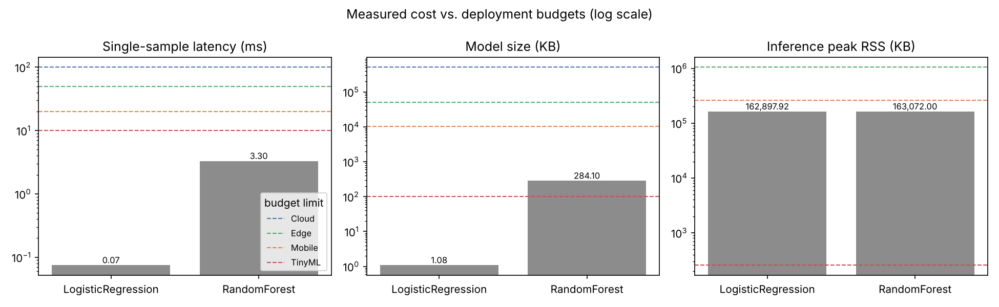

# Lab 1 — Environment and first system measurements

## 1. Goal

Set up a reproducible, pinned Python environment and use it to measure the *system* cost of two baseline classifiers on Breast Cancer Wisconsin (Diagnostic): training time, single-sample inference latency, serialized model size and peak memory. Then use those measurements to decide which deployment tiers (Cloud, Edge, Mobile, TinyML) each model can realistically run on.

## 2. Method

**Environment.** Python virtual environment created from `requirements.txt` (exact pins from the lab manual). `src/print_versions.py` prints the Python version, platform and every pinned package with its installed version, and flags mismatches; output is saved in `results/versions.txt`.

**Data and models.** `load_breast_cancer(return_X_y=True)` — 569 samples, 30 numeric features, 2 classes. 70/30 stratified split with `random_state=42` → 398 train / 171 test. All seeds set to 42 (`random`, `numpy`, `torch` when available).

| Model | Configuration |
|---|---|
| Linear | `LogisticRegression(max_iter=1000, random_state=42)` |
| Tree ensemble | `RandomForestClassifier(n_estimators=100, random_state=42)` |

No feature scaling was applied, so the models are exactly the ones specified in the manual.

**Measurements** (`src/measure_cost.py`), all with `time.perf_counter()`:

- *Training time* — 1 warm-up fit, then 5 timed fits on the full training set; median reported (min/max kept for spread).
- *Inference latency* — one test row, 1 warm-up call, then 100 timed `predict()` calls; median reported (p95 kept as tail).
- *Model size* — `joblib.dump` to `results/model_<name>.joblib`; file size in bytes and KB.
- *Peak memory* — `psutil.Process().memory_info().rss` sampled every 1 ms in a background thread during training and during the 100 inference calls. Each model is measured in a freshly spawned process so that one model cannot inflate the other's numbers. As a second view, `tracemalloc` gives the Python-heap peak (includes NumPy buffers), which isolates what the model itself allocates from the ~159 MB the interpreter + NumPy + scikit-learn occupy.

**Deployment fit** (`src/budget_table.py`). Each model is checked against the manual's exact budgets. Memory is judged two ways: *process* = peak RSS of the whole Python process (deployment as-is), *model* = max(serialized size, Python-heap peak during inference), i.e. a lower bound for a port to a lean runtime such as generated C code.

Everything runs with `python lab01/src/run_all.py`.

## 3. Results

**Accuracy** (`results/baseline_accuracy.csv`)

| Model | Test accuracy | Converged |
|---|---|---|
| LogisticRegression | 0.9415 | No (hit max_iter=1000) |
| RandomForest | 0.9357 | — |

**System cost** (`results/system_cost.csv`, raw runs in `results/timings_raw.json`)

| Metric | LogisticRegression | RandomForest |
|---|---|---|
| Training time, median of 5 (s) | 0.0713 | 0.1013 |
| Training time, min–max (s) | 0.0707–0.0722 | 0.0960–0.1173 |
| Single-sample latency, median of 100 (ms) | 0.075 | 3.305 |
| Single-sample latency, p95 (ms) | 0.102 | 3.572 |
| Model size (bytes) | 1,103 | 290,921 |
| Model size (KB) | 1.08 | 284.10 |
| Peak RSS during training (MB) | 159.01 | 158.65 |
| Peak RSS during inference (MB) | 159.08 | 159.25 |
| RSS increase during training (MB) | 1.10 | 0.68 |
| Python-heap peak, training (KB) | 47.97 | 247.70 |
| Python-heap peak, inference (KB) | 2.04 | 639.81 |

**Deployment fit** (`results/deployment_fit.csv`, plot `results/deployment_fit.png`)

| Model | Cloud | Edge | Mobile | TinyML (as Python process) | TinyML (model only, ported) |
|---|---|---|---|---|---|
| LogisticRegression | ✅ | ✅ | ✅ | ❌ memory (159 MB > 256 KB) | ✅ 1.1 KB, 0.075 ms |
| RandomForest | ✅ | ✅ | ✅ | ❌ memory, size | ❌ size 284 KB > 100 KB, heap 640 KB > 256 KB |

**Where each model can run.**

- *LogisticRegression* fits Cloud, Edge and Mobile with large margins: latency is ~270× below the 20 ms Mobile limit and the model is 1.1 KB versus a 10 MB limit. It is also the only TinyML candidate: the model is just 30 weights + 1 bias, so a microcontroller needs about 124 bytes for float32 parameters plus one dot product per prediction. It does **not** fit TinyML as a Python program, because the interpreter alone needs ~159 MB; it must be exported (e.g. hard-coded weights in C).
- *RandomForest* fits Cloud, Edge and Mobile; its 3.3 ms latency is still 6× below the Mobile limit and the 284 KB file is far below 10 MB. It fails TinyML even after porting: the serialized model is 2.8× the 100 KB budget and inference allocates ~640 KB on the heap. Making it TinyML-sized would need fewer/shallower trees (e.g. `n_estimators≈30`, `max_depth` limit) and re-measuring accuracy.

## 4. Conclusions

1. **The simpler model is the better system choice here.** Logistic regression is slightly more accurate (0.9415 vs 0.9357 — a difference of one test sample, so effectively a tie) but is ~44× faster per prediction and ~264× smaller. When accuracy is equal, the cheaper model opens up more deployment targets, all the way down to TinyML.
2. **Process overhead, not the model, dominates memory in Python.** Both models show ~159 MB peak RSS, and training/inference add only 0–1 MB on top. RSS alone therefore cannot distinguish the models; the Python-heap measurement (2 KB vs 640 KB at inference) and file size are what show their real difference. For tiny devices the runtime is the problem to solve, not the weights.
3. **Measurement method matters as much as the numbers.** Medians with warm-up give stable values (training spread was under 2% for LR, ~20% for RF), and the p95 shows the tail stays close to the median. A single run or a measurement shared in one process would have mixed one model's allocations into the other's. Also, logistic regression did not converge in 1000 iterations because features are unscaled — adding `StandardScaler` would likely speed up training and could change accuracy, which is worth testing in a later lab.

## Reproducibility note

The numbers in this report were produced on: Linux x86_64, 2 vCPU, 8 GB RAM. `results/versions.txt` lists the exact versions used for this run; any package that differs from `requirements.txt` is flagged there. Re-running `python lab01/src/run_all.py` inside the pinned Python 3.11.8 environment regenerates every file in `results/` (timings will vary with hardware; accuracies should not).
