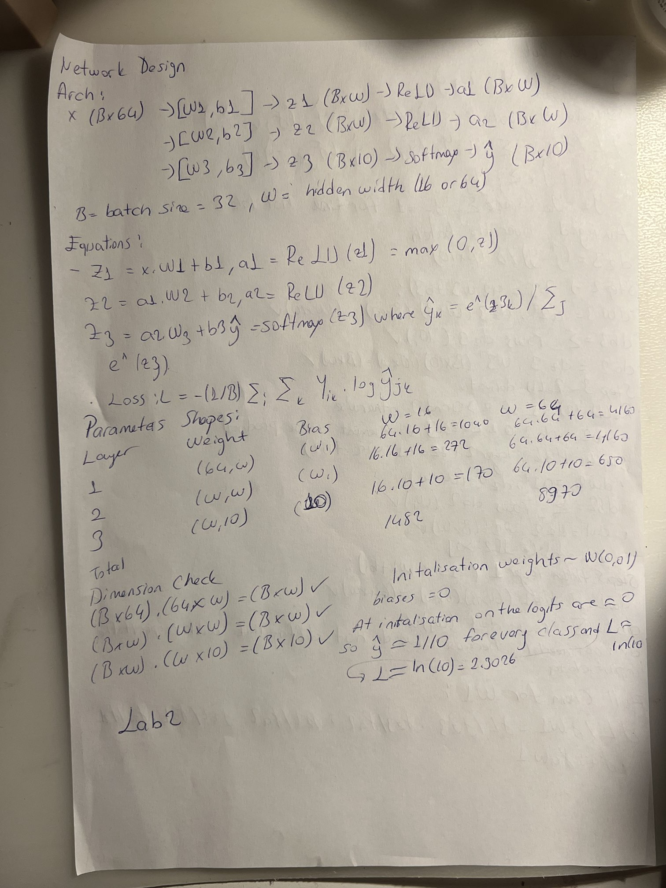
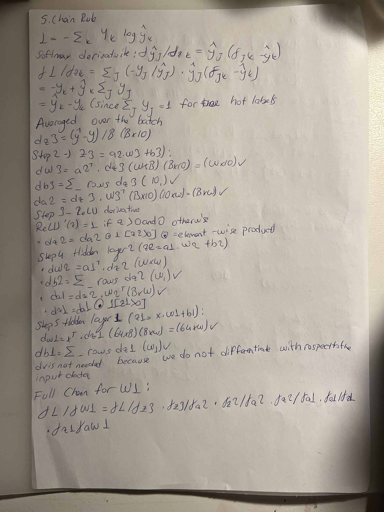
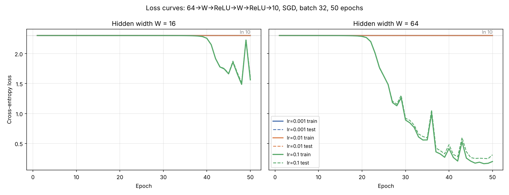

# Lab 2 — A Neural Network from Scratch (Reddi, Ch. 3)

All code is in `nn_scratch.py` (NumPy only; scikit-learn is used just to load and split the data).
Handwritten parts (Sections 2 and 5) are in `handwritten/`.
Run `cd lab02 && python src/nn_scratch.py` → regenerates everything in `lab02/results/`:
`loss_curves.png`, `results.json` (all numbers + per-epoch history), `run_log.txt` (full console log with per-epoch logging).

---

## 1. Dataset [10]

- `load_digits()`: 1797 images, 8×8 = 64 features, pixel values 0–16 → divided by 16 → range [0, 1].
- Labels one-hot encoded to shape `(N, 10)`.
- 70/30 stratified split, `random_state=42`: **train 1257 × 64, test 540 × 64**.
- Stratification check — class counts train `[124,127,124,128,127,127,127,125,122,126]`, test `[54,55,53,55,54,55,54,54,52,54]` (≈ 10 % each in both).

## 2. Network design [15]

Handwritten version (on paper): [`handwritten/part2_network_design.jpg`](handwritten/part2_network_design.jpg)



```
x (B,64) ─► z1 = xW1+b1 (B,W) ─► a1 = ReLU(z1)
          ─► z2 = a1W2+b2 (B,W) ─► a2 = ReLU(z2)
          ─► z3 = a2W3+b3 (B,10) ─► ŷ = softmax(z3)
```

| Layer | Weight | Bias | Params (W=16) | Params (W=64) |
|---|---|---|---|---|
| Input → hidden 1 | (64, W) | (W,) | 1 040 | 4 160 |
| Hidden 1 → hidden 2 | (W, W) | (W,) | 272 | 4 160 |
| Hidden 2 → output | (W, 10) | (10,) | 170 | 650 |
| **Total** | | | **1 482** | **8 970** |

Initialisation: weights ~ N(0, 0.01) (interpreted as standard deviation 0.01), biases = 0.

## 3. Forward pass [20]

Implemented layer by layer in `forward()`; softmax subtracts the row max for numerical stability.
Check on a batch of 32: output shape **(32, 10)**, max |row sum − 1| = **3.3 × 10⁻¹⁶** (< 1e-6) for both widths.

## 4. Cross-entropy loss [10]

L = −(1/N) Σᵢ Σₖ Yᵢₖ log ŷᵢₖ.
Untrained network on the full training set: **L = 2.3026** for both W = 16 and W = 64 (ln 10 = 2.3026) — with tiny weights all logits ≈ 0, so softmax is uniform (1/10 per class).

## 5. Gradients and gradient check [30]

Handwritten derivation (on paper): [`handwritten/part5_gradient_derivation.jpg`](handwritten/part5_gradient_derivation.jpg)



**Derivation (chain rule).** For softmax + cross-entropy the combined derivative is
∂L/∂z3 = (ŷ − Y)/N. Then, going backwards:

| | |
|---|---|
| dW3 = a2ᵀ dz3 | db3 = Σ_rows dz3 |
| da2 = dz3 W3ᵀ, dz2 = da2 ⊙ 1[z2 > 0] | |
| dW2 = a1ᵀ dz2 | db2 = Σ_rows dz2 |
| da1 = dz2 W2ᵀ, dz1 = da1 ⊙ 1[z1 > 0] | |
| dW1 = xᵀ dz1 | db1 = Σ_rows dz1 |

(The softmax-CE shortcut: ∂L/∂zₖ = Σⱼ (−Yⱼ/ŷⱼ)·ŷⱼ(δⱼₖ − ŷₖ) = ŷₖ Σⱼ Yⱼ − Yₖ = ŷₖ − Yₖ, since Σⱼ Yⱼ = 1.)

**Check.** 10 random weights from W1/W2/W3 (only those with a non-zero analytic gradient, since 0 = 0 tests nothing), nudged by ±1e-5, central difference
n = (L(w+ε) − L(w−ε)) / 2ε, relative error |a − n| / max(|a|, |n|) — the stricter of the common definitions. Batch of 16 training samples, untrained network.

| Width | Passed (< 1e-6) | Median rel. error |
|---|---|---|
| W = 16 | **9 / 10** ✅ | ~2 × 10⁻¹⁰ |
| W = 64 | **10 / 10** ✅ | ~1 × 10⁻¹⁰ |

Full table (analytic vs numerical for each weight) is in `results/run_log.txt` and `results/results.json`.

Two notes worth stating:

1. **Precision of the numerical side.** With N(0, 0.01) init the gradients are only ~10⁻⁵–10⁻⁷ while L ≈ 2.3. In float64 the round-off in L(w+ε) − L(w−ε) is ≈ 10⁻¹⁶ · 2.3 / 10⁻⁵ ≈ 2 × 10⁻¹¹, which by itself produces relative errors around 10⁻⁶ — right at the threshold. Plain float64 therefore passes only 6/10 and 7/10 (also logged). Evaluating the *numerical* loss in extended precision (`np.longdouble`, 64-bit mantissa) removes this floor and errors drop to ~10⁻¹⁰. The analytic gradient being tested is still the normal float64 backward pass. Larger batches make the float64 version *worse*, which confirms the cause is round-off rather than a bug.
2. **The one failure (W = 16, W2[11,12], rel. error 0.61) is a ReLU kink.** For that unit, min |z2| over the batch is 9 × 10⁻⁸, while the ±1e-5 nudge moves z2 by up to 4.5 × 10⁻⁷ — the finite difference straddles the non-differentiable point of ReLU, so the numerical slope mixes the two sides. This is the expected failure mode of gradient checking with ReLU, and is exactly why the criterion is "at least 9 of 10".

## 6. Training [20]

Mini-batch SGD, batch 32, 50 epochs, data reshuffled each epoch, train/test loss and accuracy logged every epoch (see `run_log.txt`). Same seed for every run.



| W | lr | Final train loss | Final test loss | Train acc | **Test acc** |
|---|---|---|---|---|---|
| 16 | 0.001 | 2.3025 | 2.3025 | 10.2 % | **10.2 %** |
| 16 | 0.01 | 2.3025 | 2.3025 | 10.2 % | **10.2 %** |
| 16 | 0.1 | 1.5625 | 1.6117 | 49.6 % | **50.4 %** |
| 64 | 0.001 | 2.3025 | 2.3025 | 10.2 % | **10.2 %** |
| 64 | 0.01 | 2.3023 | 2.3023 | 10.2 % | **10.2 %** |
| 64 | 0.1 | 0.1983 | 0.3096 | 93.4 % | **90.6 %** |

(The lr = 0.001 and lr = 0.01 curves lie on top of each other at ln 10, so the blue line is hidden under the orange one.)

**Interpretation.**
- **The initialisation is the bottleneck.** With std 0.01, each layer shrinks the signal by roughly 0.01·√fan-in (≈ 0.04 for W = 16, 0.08 for W = 64). After two hidden layers the logits are ~10⁻⁴, the output is uniform, and the gradients reaching W1 and W2 are tiny (the product of two small weight matrices). Training sits on a plateau at ln 10 until the weights grow enough to break symmetry.
- **Learning rate:** at lr = 0.001 and 0.01 the network never leaves the plateau within 50 epochs (≈ 2 000 updates) — accuracy stays at chance (~10 %). Only lr = 0.1 escapes.
- **Width:** W = 64 escapes the plateau around epoch 20, W = 16 only around epoch 40. Larger fan-in means each layer attenuates less (0.08 vs 0.04 per layer), so the gradient signal is ~4× stronger and learning starts sooner. W = 64 reaches **90.6 % test accuracy**; W = 16 is still mid-descent at 50.4 % when training stops.
- **Spikes at lr = 0.1:** once out of the plateau, steps of 0.1 are occasionally too large (loss jumps e.g. at epoch 36 and 49) — a sign this is near the upper edge of a stable learning rate. Train and test curves stay close, so there is little overfitting at 50 epochs.
- A He initialisation (std = √(2/fan-in)) would remove the plateau entirely; it was not used here because the lab fixes N(0, 0.01).

## 7. Timing [10]

Median of 100 runs (after 5 warm-up runs), `time.perf_counter`, single CPU process.

| W | Batch | Forward | Backward | Backward / Forward | Matmul MACs fwd → bwd |
|---|---|---|---|---|---|
| 16 | 32 | 13.2 µs | 14.4 µs | 1.09 | 46 k → 59 k (1.29×) |
| 16 | 1257 | 270 µs | 309 µs | 1.14 | 1.81 M → 2.33 M (1.29×) |
| 64 | 32 | 22.8 µs | 30.6 µs | 1.34 | 283 k → 434 k (1.54×) |
| 64 | 1257 | 829 µs | 1122 µs | 1.35 | 11.1 M → 17.1 M (1.54×) |

(Absolute times depend on the machine; the ratios are what matters.)

**Backward dominates**, and the reason is matrix multiplication:

- The forward pass does **3 matmuls**: x·W1, a1·W2, a2·W3.
- The backward pass does **5 matmuls**: for every layer the weight gradient (aᵀ·dz) *and*, for every layer except the first, the gradient w.r.t. its input (dz·Wᵀ). Each has the same multiply-add count as the matching forward matmul, so backward ≈ 2× forward minus the first layer's input gradient (which isn't needed, since we don't differentiate w.r.t. the data).
- Counting multiply-adds: for W = 64, forward = B(64·64 + 64·64 + 64·10) and backward = 2·that − B·64·64 → **1.54×**. For W = 16 the first layer (64×16) dominates the parameter count, so skipping its input gradient saves proportionally more → **1.29×**.
- Measured ratios (1.35 for W = 64, 1.14 for W = 16 at full batch) track this ordering. They are slightly below the pure-FLOP ratio because the forward pass also spends time on non-matmul work (`exp` in softmax, max-subtraction, ReLU) that doesn't scale with the matmuls, and at small sizes fixed Python/NumPy call overhead (~µs per op) flattens all ratios toward 1 — visible at batch 32, W = 16 (1.09).
- Time grows with batch and width the way matmul cost does: going from W = 16 to W = 64 multiplies MACs by ~6× and the full-batch time by ~3–3.6× (BLAS is more efficient on larger matrices). Matmuls are the dominant cost of both passes, so whichever pass has more matmuls — backward — dominates.

---

**Graded evidence summary**
- Gradient check: **9/10 (W = 16) and 10/10 (W = 64)** weights under 1e-6 ✅
- Loss curves: `results/loss_curves.png` ✅
- Timing breakdown: table above — backward ≈ 1.1–1.35× forward, explained by 5 vs 3 matmuls ✅
