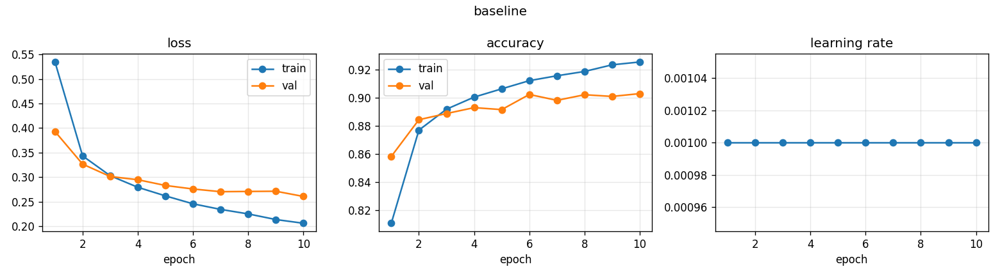
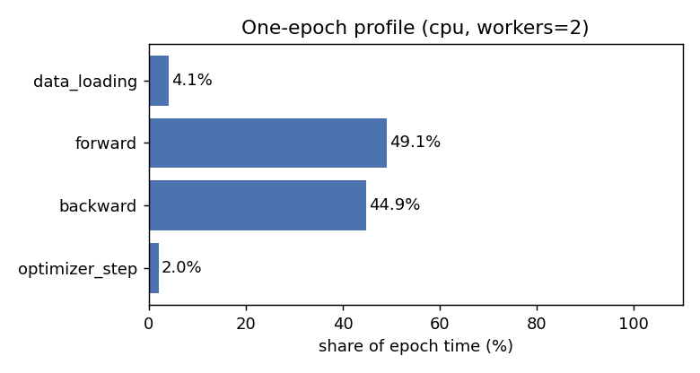
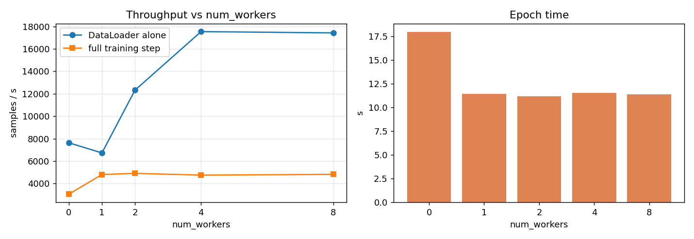
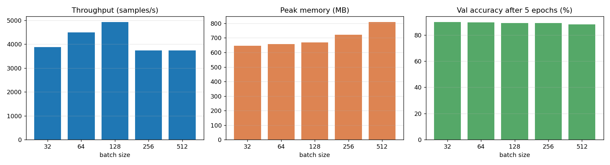
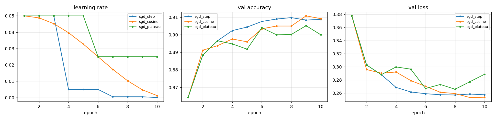
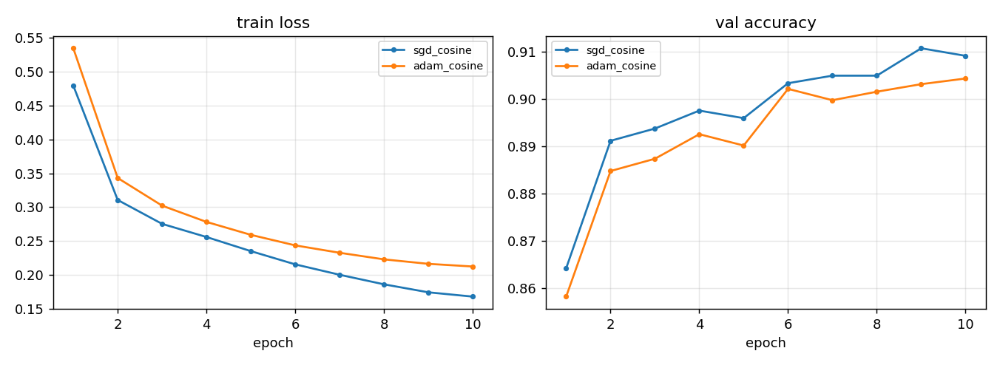
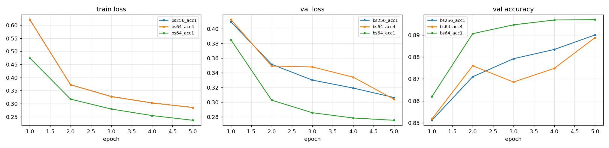
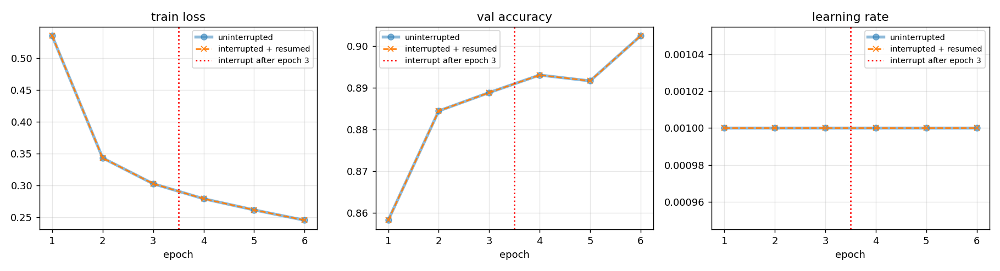

# Lab 6 — Training pipelines and project proposal

Reading: Reddi, Ch. 8 (training-system architecture, data loading, optimization, profiling, §8.7), Ch. 5 §5.5, Ch. 13 §13.3.

Model: **CNN from Lab 3** (best accuracy per parameter, see `lab03/report.md` §6), unchanged:
Conv(1,16,3,p1) → ReLU → MaxPool2 → Conv(16,32,3,p1) → ReLU → MaxPool2 → Linear(1568,10), **20,490 parameters (80 KB fp32)**.
Data: Fashion-MNIST, 55k train / 5k validation (seed 0) / 10k test, normalised as in Lab 3. Baseline as in Lab 3: Adam, lr 1e-3, batch 128.

Hardware for all numbers below: 4-vCPU Linux machine, PyTorch 2.3.1 (CPU), MLflow 2.14.1 (`results/logs/env.txt`).
Raw console output of every run is in `results/logs/`.

**Run (from `lab06/`):**
```bash
python src/train.py                       # Task 1 (any key can be overridden: --set optimizer.name=sgd ...)
python src/profile_epoch.py               # Task 2
python src/experiments.py workers|batch|sched|accum|resume|export   # Tasks 3–7, MLflow table
mlflow ui --backend-store-uri ./mlruns    # browse all runs
```

| File | Content |
|---|---|
| `configs/base.yaml` | the single config object |
| `src/train.py` | pipeline: seed, data, model, optimizer/scheduler, grad accumulation, checkpoint/resume, MLflow |
| `src/data.py`, `src/models.py` | data loaders (fixed split, seeded workers, per-epoch shuffle seed), Lab 3 CNN |
| `src/profile_epoch.py` | Task 2 |
| `src/experiments.py` | Tasks 3–7 + export of all MLflow runs |
| `results/` | tables (`table.md/.csv`), plots, logs, `mlflow_runs.csv` |
| `proposal.md` | Task 8 |

---

## 1. Reproducible YAML pipeline

One YAML object drives data, model, optimizer, scheduler, checkpointing and MLflow; `--set key=value` overrides any entry
and the merged config is what gets logged, so every run can be re-created from MLflow alone.

| Source of randomness | Fixed by |
|---|---|
| Python / NumPy / torch RNG | `set_seed(seed)` |
| train/val split | `randperm` with its own generator seeded by `seed` |
| shuffle order | sampler generator re-seeded with `seed + epoch` before every epoch |
| worker processes | `worker_init_fn` seeds NumPy / `random` from the worker's torch seed |

**Checkpoint** (`checkpoints/<run>/last.pt`, written atomically every epoch): model, optimizer state, scheduler state, epoch,
best accuracy, RNG states, metric history, MLflow run id. `best.pt` = weights with the best validation accuracy.

**MLflow:** params = whole config + parameter count + size + effective batch; metrics per epoch = train/val loss and accuracy,
lr, samples/s, epoch time, peak memory; final test accuracy; artifacts = `config.yaml`, `history.csv`, `curves.png`, `model/best.pt`.
**22 runs** were logged (list: `results/mlflow_runs.csv`).

Baseline (10 epochs): **val acc 90.30 %, test acc 90.52 %**, ≈ 4,950 samples/s. Curves: `results/baseline/curves.png`.



---

## 2. Profile of one epoch (`torch.profiler`, 429 steps, batch 128, 2 workers)

Each region is wrapped in `record_function`; the device is synchronised at the end of each region so asynchronous kernels are
charged to the right region (no effect on CPU, required on GPU/MPS).

| Region | Time (s) | Share |
|---|---:|---:|
| Data loading (next batch + copy) | 0.67 | **4.1 %** |
| Forward pass | 8.04 | **49.1 %** |
| Backward pass | 7.35 | **44.9 %** |
| Optimizer step (Adam + zero_grad) | 0.32 | **2.0 %** |



- **94 % of the time is forward + backward → the epoch is compute-bound.** With 2 workers the input pipeline is hidden almost completely.
- Top operators (`results/profile/profiler_table.txt`): `convolution_backward` 26.6 %, `max_pool2d_with_indices` 21.9 %, `mkldnn_convolution` 19.0 %, ReLU 6.4 %.
  Max-pooling is unusually expensive on CPU: it is purely memory-bound (reads the large 16×28×28 activation, almost no arithmetic).
- Backward ≈ forward here (usually ~2×) because the forward is dominated by the memory-bound max-pool, while backward of max-pool is cheap.
- The optimizer step is only 2 %: one element-wise update of 20k parameters.

---

## 3. num_workers study (1 epoch each)

| num_workers | DataLoader alone (samples/s) | Training (samples/s) | Epoch time (s) |
|---:|---:|---:|---:|
| 0 | 7,632 | 3,058 | 18.0 |
| 1 | 6,731 | 4,807 | 11.4 |
| 2 | 12,326 | **4,907** | **11.2** |
| 4 | 17,543 | 4,754 | 11.6 |
| 8 | 17,428 | 4,816 | 11.4 |



**Bottleneck.** With `num_workers = 0` loading and computing run one after the other in the same process, so their times add:
1/3,058 = 1/7,632 + 1/compute → **compute ≈ 5,100 samples/s**. With ≥ 1 worker loading overlaps with compute and training jumps to
≈ 4,800–4,900 samples/s, i.e. exactly that compute limit. From 2 workers on the loader alone delivers 12–17k samples/s,
2.5–3.5× more than the model can consume, so **the bottleneck is the model compute (CPU convolutions), not data loading**;
more workers do not help. 8 workers give nothing over 4 (only 4 CPUs; PyTorch even warns), and start-up time rises (0.02 s → 0.27 s to first batch).
1 worker alone is slower than 0 for the pure loader because of inter-process transfer, but it still wins in training because of the overlap.
**Choice: 2 workers** (used in all other runs).

---

## 4. Batch-size study (5 epochs, Adam 1e-3, same lr for every batch)

| Batch | Steps / epoch | Throughput (samples/s) | Peak memory (MB) | Val acc after 5 ep. | Test acc |
|---:|---:|---:|---:|---:|---:|
| 32 | 1,718 | 3,876 | 647 | **89.80 %** | **90.19 %** |
| 64 | 859 | 4,490 | 657 | 89.70 % | 90.10 % |
| 128 | 429 | **4,927** | 669 | 89.16 % | 88.83 % |
| 256 | 214 | 3,738 | 721 | 89.00 % | 88.75 % |
| 512 | 107 | 3,737 | 809 | 88.00 % | 88.13 % |



- **Throughput** grows from 32 to 128 (less per-step Python/launch overhead), then **drops** for 256/512 on this CPU:
  the conv1 output of one batch is B·16·28·28·4 B = 6.4 MB at 128 but 25.7 MB at 512, which no longer fits in the CPU caches,
  so the memory-bound max-pool/ReLU layers slow down. (On a GPU throughput would keep rising up to saturation.)
- **Memory** is ≈ 640 MB of fixed process memory (Python, PyTorch, MLflow) plus a part that grows **linearly** with B:
  +162 MB from 32 to 512. Hand estimate: forward activations 0.164 MB/sample × 480 = 79 MB, and backward holds gradient buffers of
  the same size, ≈ 2 × 79 = 158 MB — matches the measurement.
- **Accuracy** falls monotonically with batch size: with a fixed 5-epoch budget and fixed lr, batch 512 makes 16× fewer updates
  (535 vs 8,590), and small batches add gradient noise that regularises. The linear scaling rule (lr ∝ B) would reduce this gap.
- **Trade-off:** batch 128 is the best compromise here (highest throughput, < 1 pp below the best accuracy).

---

## 5. Learning-rate schedules and optimizers (10 epochs each)

SGD + momentum 0.9, lr 0.05; Adam lr 1e-3; StepLR(3, 0.1), CosineAnnealingLR(T_max=10), ReduceLROnPlateau(factor 0.5, patience 1).

| Run | Final val acc | Best val acc (epoch) | Final train loss | Test acc |
|---|---:|---:|---:|---:|
| SGD + StepLR | 90.88 % | 90.98 % (8) | 0.200 | 90.63 % |
| **SGD + Cosine** | **90.92 %** | **91.08 % (9)** | **0.168** | **91.09 %** |
| SGD + Plateau | 90.00 % | 90.52 % (9) | 0.191 | 90.55 % |
| Adam + Cosine | 90.44 % | 90.44 % (10) | 0.212 | 90.61 % |



- **StepLR:** big jump right after the first drop (epoch 4: 89.7 → 90.2 %), but after the second drop (lr = 5e-4 from epoch 7)
  learning practically stops — train loss 0.2018 → 0.1997 over the last 4 epochs. step_size = 3 is too early for 10 epochs.
- **Cosine:** smooth decay; keeps a useful lr longer and anneals to ~0 only at the end → lowest train loss, best val and test accuracy.
- **Plateau:** reacts only after the validation loss stalls; it halved the lr once (epoch 6), so lr stayed at 0.025 until the end,
  and the val loss starts rising again (0.266 → 0.289, overfitting/noise) → worst final result. Adaptive, but late and noisy.

**SGD+momentum vs Adam (same 10 epochs, batch, data and cosine schedule):** SGD ends at **91.09 %** test accuracy vs **90.61 %** for Adam,
and a lower train loss (0.168 vs 0.212). Adam is not faster here (epoch 1: 85.8 % vs 86.4 % for SGD with its larger lr).
Adam also needs two state tensors per parameter (vs one for momentum), i.e. more optimizer memory.



---

## 6. Gradient accumulation (batch 64 × 4 = effective 256, 5 epochs)

Each micro-batch loss is divided by the number of micro-batches in its group, `backward()` adds into `.grad`, and
`step()` + `zero_grad()` run once per group:
∇L₂₅₆ = (1/256) Σᵢ ∇ℓᵢ = (1/4) Σₖ₌₁⁴ ∇L₆₄⁽ᵏ⁾.

| Run | Effective batch | Optimizer steps / epoch | Final train loss | Final val acc | Test acc | Peak memory (MB) | Samples/s |
|---|---:|---:|---:|---:|---:|---:|---:|
| batch 256 | 256 | 214 | 0.2854 | 89.00 % | 88.75 % | 701 | 4,953 |
| **batch 64 × accum 4** | 256 | 215 | **0.2852** | **88.88 %** | **88.91 %** | 687 | 4,501 |
| batch 64 (reference) | 64 | 859 | 0.2364 | 89.70 % | 90.10 % | 682 | 4,517 |



- **Training behaviour is the same:** train loss differs by 0.0002, accuracies by ≤ 0.16 pp, and the curves lie on top of each other,
  while plain batch 64 (4× more updates) behaves clearly differently.
- Why not bit-identical: (1) the last group of an epoch has only 3 micro-batches (859 = 4·214 + 3 → 215 steps instead of 214),
  so batch 64×4 sees 192 more samples per epoch (54,976 vs 54,784); (2) floating-point summation order. This CNN has **no BatchNorm**, otherwise the
  statistics over 64 instead of 256 samples would be another difference.
- **Cost:** memory and speed are those of batch 64 (687 MB, 4,501 samples/s), not of batch 256 → accumulation buys the large-batch
  optimisation behaviour at small-batch memory cost.

---

## 7. Interrupt at epoch 3 and resume

The run was stopped after epoch 3 (`train.stop_after_epoch=3`) and restarted with `checkpoint.resume=auto`; it was compared with
an identical run that was not interrupted (6 epochs).

| Epoch | | Train loss (uninterrupted / resumed) | Val acc (uninterrupted / resumed) |
|---:|---|---|---|
| 1–3 | before | 0.5347 / 0.5347 · 0.3433 / 0.3433 · 0.3029 / 0.3029 | 85.82 / 85.82 · 88.44 / 88.44 · 88.88 / 88.88 |
| 4 | **after resume** | 0.2794 / 0.2794 | 89.30 / 89.30 |
| 5 | after resume | 0.2619 / 0.2619 | 89.16 / 89.16 |
| 6 | after resume | 0.2457 / 0.2457 | 90.24 / 90.24 |



The resumed curves continue without any jump and are **identical** to the uninterrupted run (to 4 decimals), and the metrics continue
in the **same MLflow run** (one continuous line). This works because the checkpoint holds, besides the weights:
the **optimizer state** (Adam moments — otherwise a loss spike), the **scheduler state** (otherwise the lr restarts at lr₀),
the **epoch counter**, and the **RNG states** together with the per-epoch shuffle seed (same data order after the restart).

---

## 8. Individual project proposal

See [`proposal.md`](proposal.md).

---

## Hand calculations (handwritten version: `handwritten/`)

**Parameters / model size:** 160 + 4,640 + 15,690 = 20,490 parameters × 4 B = 80 KB (fp32).
Optimizer state: SGD+momentum +1 copy (80 KB), Adam +2 copies (160 KB).

**Steps per epoch** = ⌊55,000 / B⌋ (drop_last): 32 → 1,718; 64 → 859; 128 → 429; 256 → 214; 512 → 107.

**Activation memory per sample (forward, fp32):**
input 784 + conv1 12,544 + ReLU 12,544 + pool 3,136 + conv2 6,272 + ReLU 6,272 + pool 1,568 = 43,120 floats = **0.164 MB**
→ batch 32: 5.3 MB, batch 512: 84 MB (×≈2 with the backward buffers).

**Learning rate per epoch (lr₀ = 0.05):** StepLR: lr₀·0.1^⌊(e−1)/3⌋; Cosine: ½·lr₀·(1 + cos(π(e−1)/10)).

| Epoch | 1 | 2 | 3 | 4 | 5 | 6 | 7 | 8 | 9 | 10 |
|---|---|---|---|---|---|---|---|---|---|---|
| StepLR | 0.05 | 0.05 | 0.05 | 0.005 | 0.005 | 0.005 | 0.0005 | 0.0005 | 0.0005 | 0.00005 |
| Cosine | 0.0500 | 0.0488 | 0.0452 | 0.0397 | 0.0327 | 0.0250 | 0.0173 | 0.0103 | 0.0048 | 0.0012 |

**Compute limit from the num_workers study:** 1/3,058 − 1/7,632 = 1/5,100 → model compute ≈ 5,100 samples/s.
